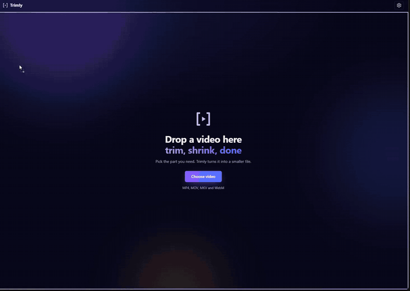
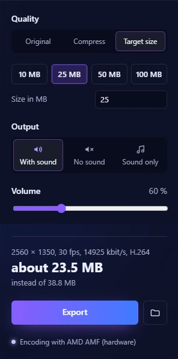

<h1 align="center">Trimly</h1>

<p align="center"><b>Cut it. Shrink it. Send it.</b></p>

<p align="center">
  <a href="https://github.com/Florian11111/Trimly/actions/workflows/test.yml"></a>
</p>

<p align="center">
  <a href="https://github.com/Florian11111/Trimly/releases/latest">Download</a> ·
  <a href="#install">Install</a> ·
  <a href="#for-developers">Developers</a>
</p>


<sub>Video: [A pond in the middle of a forest](https://www.pexels.com/video/a-pond-in-the-middle-of-a-forest-with-tall-grass-20732245/) on Pexels</sub>

<table>
<tr>
<td width="62%" valign="top">

#### Too big to send?
**Target size** → type 20 MB. Trimly picks bitrate, resolution and frame rate.

#### Too long?
Drag the handles, choose **Original**. No re-encoding, done in a second.

#### Too blurry after compressing?
**Compress** shows the size live while you switch between 480p, 720p and 1080p.

#### Too slow?
Your GPU does the work: NVIDIA, AMD, Intel, Apple or VA-API.

</td>
<td width="38%" valign="top">

</td>
</tr>
</table>

Also: H.264 / HEVC / AV1 · sound only as MP3 · editor with clips, speed, crop, text and zoom · undo · never makes a file bigger.

## Install

| Windows 10/11 | macOS 11+ (Apple Silicon) | Linux |
|---|---|---|
| `…_x64-setup.exe` | `…_aarch64.dmg` | `.deb` · `.rpm` · `.AppImage` |
| ffmpeg included | `brew install ffmpeg` | ffmpeg from package manager |

Not code-signed yet: Windows → *More info → Run anyway*, macOS → right-click → *Open*.
Right-click any video → *Open with → Trimly*.

**Keys:** <kbd>Space</kbd> play · <kbd>I</kbd>/<kbd>O</kbd> start/end · <kbd>←</kbd>/<kbd>→</kbd> 5 s · <kbd>,</kbd>/<kbd>.</kbd> frame · <kbd>M</kbd> mute · <kbd>⌘</kbd>/<kbd>Ctrl</kbd>+<kbd>Z</kbd> undo

## For developers

<details>
<summary><b>Self-hosting the web version</b></summary>

The same interface also runs in the browser, with a server doing the encoding. Useful on a home
server or for people who can't install apps.

You need [Docker](https://docs.docker.com/get-docker/) with Compose.

```bash
git clone https://github.com/Florian11111/Trimly.git
cd Trimly
docker compose up --build
```

Open <http://localhost:3000>. The backend runs on port 9000. Stop it with `docker compose down`.

**Production**, with nginx on port 80 in front of both:

```bash
APPLICATION_SECRET=$(openssl rand -base64 32) \
  docker compose -f docker-compose.prod.yml up --build -d
```

| Setting | Where | Default |
|---|---|---|
| Upload limit | `nginx.conf`, `backend/conf/application.conf` | 20 GB |
| NVIDIA GPU encoding | add `-f docker-compose.gpu.yml` | off |
| Windows one-click start | `start-trimly.bat` | |

The web version currently encodes H.264 only. Uploaded files are temporary: the server deletes them
after a while and forgets them when it restarts.
</details>

<details>
<summary><b>Building on Windows</b></summary>

Install the tools (open a new terminal afterwards, otherwise `npm` isn't found):

```bash
winget install OpenJS.NodeJS.LTS Rustlang.Rustup MSYS2.MSYS2
winget install Microsoft.VisualStudio.2022.BuildTools --override "--quiet --wait --add Microsoft.VisualStudio.Workload.VCTools --includeRecommended"
```

Build the bundled ffmpeg once, in the *MSYS2 UCRT64* shell. It's a small static build (~18 MB) that
ends up next to `trimly.exe`; without it the Windows build fails:

```bash
cd frontend/src-tauri && bash scripts/build-ffmpeg.sh
```

Then build the app:

```bash
cd frontend && npm ci && npm run desktop:build
```

The installer is in `frontend/src-tauri/target/release/bundle/nsis/`, an `.msi` in `bundle/msi/`.
</details>

<details>
<summary><b>Building on macOS</b></summary>

You need [Homebrew](https://brew.sh):

```bash
brew install ffmpeg node rust
cd frontend && npm ci && npm run desktop:build
```

The `.app` and `.dmg` are in `frontend/src-tauri/target/release/bundle/`. macOS uses the ffmpeg from
Homebrew; Trimly also finds it when started from the Finder.
</details>

<details>
<summary><b>Building on Linux</b> (Debian/Ubuntu)</summary>

```bash
sudo apt install build-essential curl file libwebkit2gtk-4.1-dev libxdo-dev libssl-dev \
  libayatana-appindicator3-dev librsvg2-dev ffmpeg nodejs npm \
  gstreamer1.0-plugins-good gstreamer1.0-plugins-bad gstreamer1.0-libav
curl --proto '=https' --tlsv1.2 -sSf https://sh.rustup.rs | sh
cd frontend && npm ci && npm run desktop:build
```

If Node.js is already installed (e.g. from NodeSource), leave out `nodejs npm`, otherwise apt
reports a conflict. The GStreamer plugins are needed for the video preview. The `.deb`, `.rpm` and
`.AppImage` are in `frontend/src-tauri/target/release/bundle/`. On Intel and AMD GPUs Trimly encodes
with VA-API; `TRIMLY_VAAPI_DEVICE` picks another card than `/dev/dri/renderD128`.
</details>

<details>
<summary><b>Developing and tests</b></summary>

```bash
cd frontend && npm run desktop     # desktop app with hot reload
cd frontend && npm start           # only the interface, in the browser (talks to the backend on :9000)
```

| Variable | Effect |
|---|---|
| `TRIMLY_ENCODER=cpu` | Force software encoding (libx264) |
| `TRIMLY_VAAPI_DEVICE` | Linux: VA-API device, default `/dev/dri/renderD128` |

Tests:

```bash
cd frontend && CI=true npm test -- --watchAll=false
cd frontend/src-tauri && cargo test
docker compose run --rm backend sbt -batch test
```

The Rust and backend tests call the real ffmpeg with `backend/test/resources/testVideo.mp4`. If ffmpeg
or the video is missing, those tests are skipped instead of failing.
</details>

## License

Trimly is licensed under the [GNU General Public License v3.0 or later](LICENSE).

The Windows build ships ffmpeg compiled with libx264 (GPL); its source is at
[ffmpeg.org](https://ffmpeg.org/releases/), the build script is in
`frontend/src-tauri/scripts/build-ffmpeg.sh`.