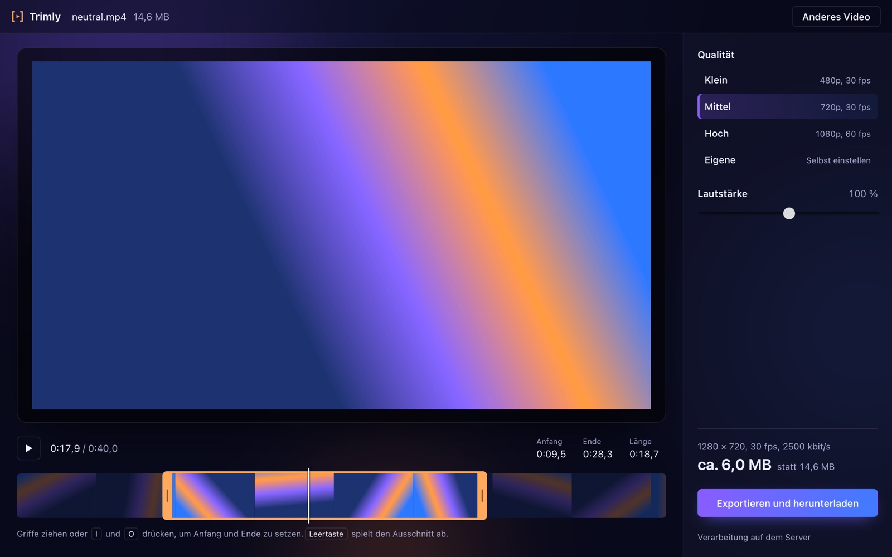
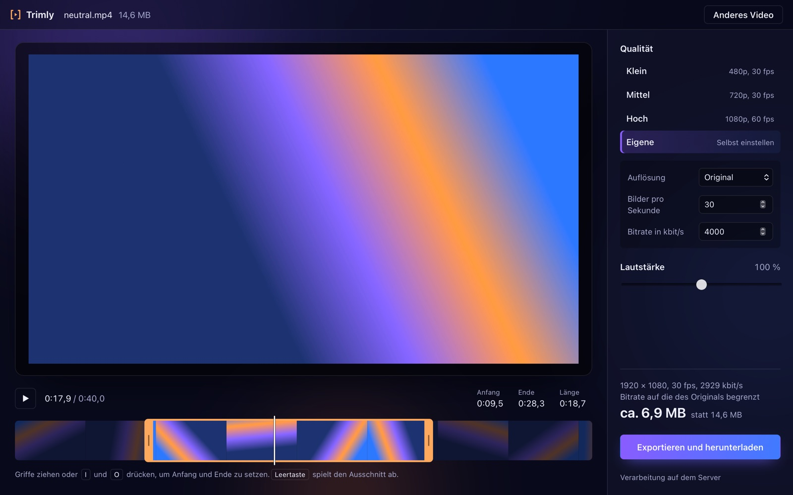
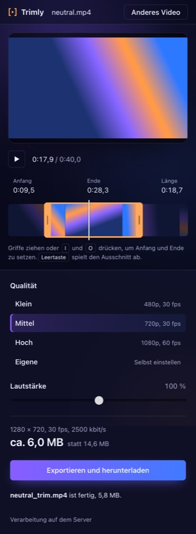
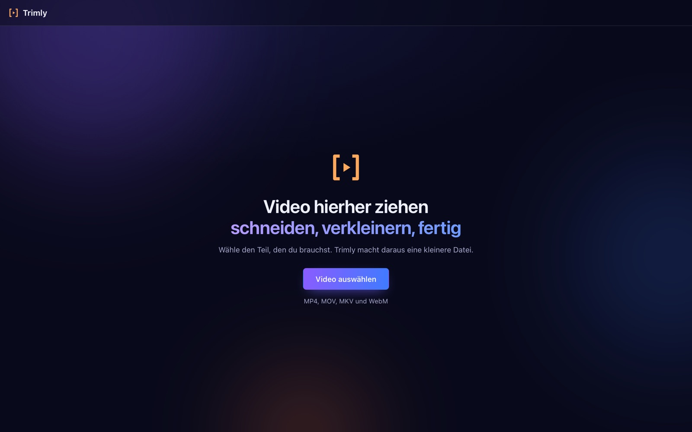

# Trimly

Videos schneiden und verkleinern. Video reinziehen, Anfang und Ende mit der gelben Klammer setzen, Qualität wählen, exportieren.

Trimly gibt es in zwei Varianten mit derselben Oberfläche:

- **Desktop-App (macOS):** startet sofort und arbeitet direkt mit der Datei auf deinem Mac, ohne Upload. Kodiert per Hardware mit Apple VideoToolbox.
- **Web-Version:** läuft im Browser mit einem Server, auf dem ffmpeg rechnet. Die Web-Version läuft komplett in Docker.



## Funktionen

- **Schneiden auf dem Filmstreifen:** Griffe ziehen, oder <kbd>I</kbd> und <kbd>O</kbd> drücken, um Anfang und Ende auf die Abspielposition zu setzen. <kbd>Shift</kbd> + Klick und <kbd>Alt</kbd> + Klick gehen auch.
- **Qualität:** Klein (480p), Mittel (720p) und Hoch (1080p). Unter Eigene stellst du Auflösung, Bilder pro Sekunde und Bitrate selbst ein. Trimly skaliert nie hoch und behält das Seitenverhältnis, auch bei Hochformat.
- **Nur schneiden (Desktop):** übernimmt die Videospur unverändert und ist dadurch in Sekunden fertig. Geschnitten wird dabei an Keyframes.
- **Lautstärke:** 0 bis 200 % für die Tonspur im Ergebnis.
- **Größenschätzung:** zeigt schon vor dem Export, wie groß die Datei ungefähr wird.

<p>
  
  
</p>

### Tastatur

| Taste | Aktion |
|---|---|
| <kbd>Leertaste</kbd> | Ausschnitt abspielen / anhalten |
| <kbd>←</kbd> / <kbd>→</kbd> | 5 s zurück / vor |
| <kbd>,</kbd> / <kbd>.</kbd> | ein Bild zurück / vor |
| <kbd>I</kbd> / <kbd>O</kbd> (oder <kbd>S</kbd> / <kbd>E</kbd>) | Anfang / Ende setzen |
| <kbd>←</kbd> / <kbd>→</kbd> auf einem Griff | Griff um 0,1 s verschieben, mit <kbd>Shift</kbd> um 1 s |

## Desktop-App (macOS)

Voraussetzungen: [Homebrew](https://brew.sh), dann:

```bash
brew install ffmpeg node rust
```

Starten zum Entwickeln, mit Hot Reload:

```bash
cd frontend && npm install && npm run desktop
```

Als App bauen (`.app` und `.dmg` landen in `frontend/src-tauri/target/release/bundle/`):

```bash
cd frontend && npm run desktop:build
```

Die App sucht ffmpeg im `PATH` sowie in `/opt/homebrew/bin` und `/usr/local/bin`. Kennt ffmpeg `h264_videotoolbox`, kodiert sie per Hardware, sonst mit libx264. Unten in der Export-Spalte steht, welcher Encoder aktiv ist.

### Wie schnell?

Gemessen auf einem MacBook mit M5 und einem 19-Sekunden-Video in 1440p bei 60 fps:

| Weg | → 720p30 | → 1440p60 |
|---|---|---|
| Web-Version (Docker, libx264) | 5,0 s | 19,8 s |
| Desktop, VideoToolbox | 1,8 s | 7,5 s |
| Desktop, Nur schneiden | sofort | sofort |

Dazu kommt in der Web-Version noch der Upload.

## Web-Version

Voraussetzung: [Docker](https://www.docker.com/get-started) mit Docker Compose.

```bash
git clone https://github.com/Florian11111/Trimly.git
cd Trimly
docker compose up --build
```

Danach läuft das Frontend auf <http://localhost:3000> und das Backend auf <http://localhost:9000>. Beenden mit `docker compose down`.



### Produktion

In der Produktion liegt nginx auf Port 80 vor Frontend und Backend:

```bash
APPLICATION_SECRET=$(openssl rand -base64 32) docker compose -f docker-compose.prod.yml up --build -d
```

Uploads sind auf 500 MB begrenzt (`nginx.conf`, `backend/conf/application.conf`).

## Tests

```bash
docker compose run --rm backend sbt -batch test
```

```bash
cd frontend && CI=true npm test -- --watchAll=false
```

```bash
cd frontend/src-tauri && cargo test
```

Backend- und Rust-Tests rufen das echte ffmpeg mit `backend/test/resources/testVideo.mp4` auf. Fehlen ffmpeg oder das Video, werden diese Tests übersprungen statt rot zu werden.

## Aufbau

| Teil | Technik | Ort |
|---|---|---|
| Oberfläche | React 19 (Create React App) | `frontend/src/` |
| Desktop | Tauri 2, Rust, ruft ffmpeg direkt auf | `frontend/src-tauri/` |
| Server | Scala 2.13, Play Framework 3 | `backend/` |
| Verarbeitung | ffmpeg / ffprobe, H.264 + AAC | |

Die Oberfläche spricht über eine kleine Plattform-Schicht (`frontend/src/platform/`) entweder mit dem Server (`web.js`) oder mit Rust (`desktop.js`). Welche gilt, entscheidet sich beim Start daran, ob die Seite in Tauri läuft.
