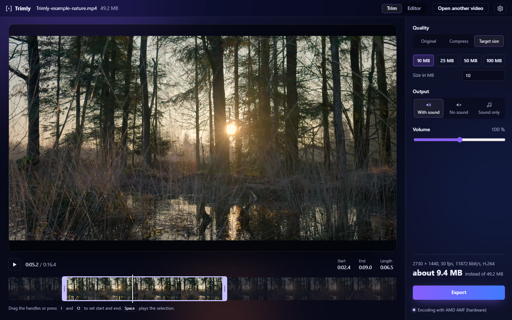
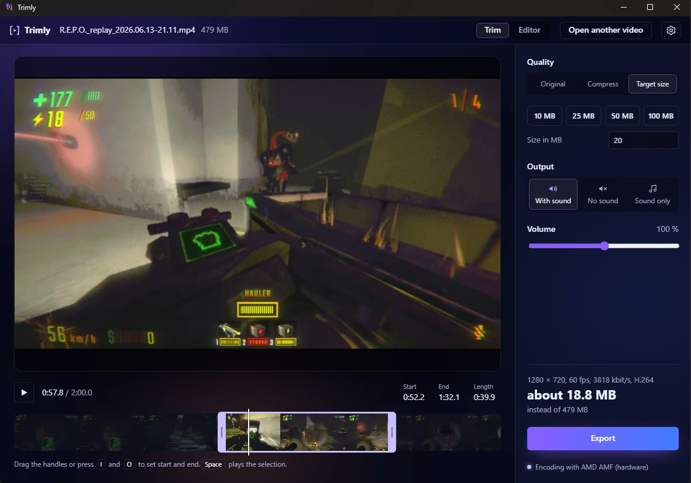

<h1 align="center">Trimly</h1>

<p align="center">
  Lightweight and fast tool to easily cut and compress videos.
</p>

<p align="center">
  <a href="https://github.com/Florian11111/Trimly/releases/latest">Download</a> ·
  <a href="#features">Features</a> ·
  <a href="#self-hosting-the-web-version">Web version</a> ·
  <a href="#building-from-source">Build from source</a>
</p>

<picture>
  <source media="(prefers-color-scheme: light)" srcset="docs/images/hero-light.jpg">
  
</picture>
<sub>Video: [A pond in the middle of a forest](https://www.pexels.com/video/a-pond-in-the-middle-of-a-forest-with-tall-grass-20732245/) on Pexels</sub>

**Open video → choose the interesting part → select quality → export.**
No account, no subscription, no upload. Just speed.

- **Target size** for upload limits (10, 25, 100 MB …)
- **Original**: cut without re-encoding, done in a second
- **Compress**: Small, Medium, High or custom
- **Exact size before saving**: calculate first, then export instantly
- **Hardware encoding**: NVIDIA, AMD, Intel, Apple, VA-API on Linux · H.264, HEVC, AV1
- **Right-click → Open with → Trimly**

## Download

| Platform | File | Notes |
|---|---|---|
| Windows 10/11 (x64) | `Trimly_x.y.z_x64-setup.exe` | ffmpeg is included |
| macOS 11+ (Apple Silicon) | `Trimly_x.y.z_aarch64.dmg` | ffmpeg is included |
| Linux (x64, ARM64) | `.deb`, `.rpm` or `.AppImage` | needs ffmpeg from your package manager (the `.deb` installs it) |

All files are on the [releases page](https://github.com/Florian11111/Trimly/releases).
The builds aren't code-signed yet. Windows shows a SmartScreen warning (*More info → Run anyway*),
on macOS right-click the app and choose *Open* the first time.

## Features


### Opening videos

Drop a video onto the window, use *Open with → Trimly* in Finder or Explorer, or press
<kbd>⌘</kbd>/<kbd>Ctrl</kbd> + <kbd>O</kbd> (on macOS also *File → Open New File…*). The home button
in the top bar goes back to the start screen. MP4, MOV, MKV, WebM and AVI work; Trimly never becomes
your default video app.

### Trimming

Click anywhere on the film strip to jump there. Hold a handle to drag it, or press <kbd>I</kbd> and
<kbd>O</kbd> to set start and end at the playhead. <kbd>Space</kbd> plays only the selection. The
small speaker next to the time sets the playback volume; it doesn't change the export.
<kbd>⌘</kbd>/<kbd>Ctrl</kbd> + <kbd>Z</kbd> undoes changes to the selection and settings.

### Quality

| Mode | What it does | Good for |
|---|---|---|
| **Original** | Cuts without re-encoding. Same quality, done in a second. Cuts land on keyframes. | Long recordings, quick trims |
| **Compress** | Small (480p), Medium (720p), High (1080p) or custom values | Sharing, archiving |
| **Target size** | Picks bitrate, resolution and frame rate so the file stays under the size you set | Discord, email, forums, chat apps |

Trimly never scales up and never uses more bitrate than the original, so a file can't get bigger by
compressing it. The size estimate in the sidebar updates as you change things.

Need the exact number? The small arrow next to *Export* has **Calculate exact size**: Trimly encodes
the clip without saving it and shows the real size. If you leave the settings as they are, *Export*
then saves the finished file instantly. Changing anything discards it.

#### Good for file transfers with a limit, e.g. Discord



### Output

Video with sound, video without sound, or only the sound as MP3. Volume from 0 to 200 %.

### Formats and encoders

H.264 plays everywhere. HEVC and AV1 give the same quality at roughly 30 to 40 % less size, but need
a newer player. Choose the format and the encoder (automatic, a specific GPU, or CPU) in the
settings. On startup Trimly runs a short test encode on every hardware encoder and only offers the
ones that work on your machine. If the hardware fails on a single video, Trimly encodes it again
with libx264. The line under the export button shows which encoder is active.

| 19 s clip, 1440p60 | → 720p30 | → 1440p60 |
|---|---|---|
| MacBook (M5), VideoToolbox | 1.8 s | 7.5 s |
| Web version in Docker, libx264 | 5.0 s | 19.8 s |
| *Original* (cut only) | instant | instant |

### Editor

The *Editor* tab combines several clips, lets you detach and move the audio, changes speed, crops,
and adds arrows, text, images and zooms.


### Settings

Dark, light or system theme, four accent colors, video format, encoder and a default export folder.
With a default folder, *Export* saves there right away; the folder button next to it still asks.

### Keyboard

| Key | Action |
|---|---|
| <kbd>Space</kbd> | Play / pause the selection |
| <kbd>←</kbd> / <kbd>→</kbd> | 5 s back / forward |
| <kbd>,</kbd> / <kbd>.</kbd> | One frame back / forward |
| <kbd>I</kbd> / <kbd>O</kbd> | Set start / end |
| <kbd>M</kbd> | Mute / unmute the player |
| <kbd>←</kbd> / <kbd>→</kbd> on a handle | Move it 0.1 s, with <kbd>Shift</kbd> 1 s |
| <kbd>⌘</kbd>/<kbd>Ctrl</kbd> + <kbd>O</kbd> | Open another video |
| <kbd>⌘</kbd>/<kbd>Ctrl</kbd> + <kbd>Z</kbd> | Undo (redo: <kbd>⌘</kbd> + <kbd>⇧</kbd> + <kbd>Z</kbd> or <kbd>Ctrl</kbd> + <kbd>Y</kbd>) |

## Self-hosting the web version

The same interface also runs in the browser, with a server doing the encoding. Useful on a home
server or for people who can't install apps.

You need [Docker](https://docs.docker.com/get-docker/) with Compose.

```bash
git clone https://github.com/Florian11111/Trimly.git
cd Trimly
docker compose up --build
```

Open <http://localhost:3000>. The backend runs on port 9000.

**Production**, with nginx on port 80 in front of both:

```bash
APPLICATION_SECRET=$(openssl rand -base64 32) \
  docker compose -f docker-compose.prod.yml up --build -d
```

| Setting | Where | Default |
|---|---|---|
| Upload limit | `nginx.conf`, `backend/conf/application.conf` | 20 GB |
| NVIDIA GPU encoding | add `-f docker-compose.gpu.yml` | off |
| Windows one-click start | `start-trimly.bat` | |

The web version currently encodes H.264 only. Uploaded files are temporary: the server deletes them
after a while and forgets them when it restarts.

## Building from source

<details>
<summary><b>Windows</b></summary>

```bash
winget install OpenJS.NodeJS.LTS Rustlang.Rustup MSYS2.MSYS2
winget install Microsoft.VisualStudio.2022.BuildTools --override "--quiet --wait --add Microsoft.VisualStudio.Workload.VCTools --includeRecommended"
```

Build the bundled ffmpeg once, in the *MSYS2 UCRT64* shell:

```bash
cd frontend/src-tauri && bash scripts/build-ffmpeg.sh
```

Then:

```bash
cd frontend && npm ci && npm run desktop:build
```

The installer is in `frontend/src-tauri/target/release/bundle/nsis/`.
</details>

<details>
<summary><b>macOS</b></summary>

```bash
brew install node rust nasm pkgconf meson ninja x264 lame mpg123
cd frontend/src-tauri && bash scripts/build-ffmpeg.sh   # once: builds the bundled ffmpeg
cd .. && npm ci && npm run desktop:build
```

The `.app` and `.dmg` are in `frontend/src-tauri/target/release/bundle/`.
</details>

<details>
<summary><b>Linux</b> (Debian/Ubuntu)</summary>

```bash
sudo apt install build-essential curl file libwebkit2gtk-4.1-dev libxdo-dev libssl-dev \
  libayatana-appindicator3-dev librsvg2-dev ffmpeg nodejs npm \
  gstreamer1.0-plugins-good gstreamer1.0-plugins-bad gstreamer1.0-libav
curl --proto '=https' --tlsv1.2 -sSf https://sh.rustup.rs | sh
cd frontend && npm ci && npm run desktop:build
```

If Node.js is already installed (e.g. from NodeSource), leave out `nodejs npm`, otherwise apt
reports a conflict. The GStreamer plugins are needed for the video preview. The `.deb`, `.rpm` and `.AppImage` are in
`frontend/src-tauri/target/release/bundle/`. On Intel and AMD GPUs Trimly encodes with VA-API;
`TRIMLY_VAAPI_DEVICE` picks another card than `/dev/dri/renderD128`.
</details>

`npm run desktop` starts the app with hot reload. `TRIMLY_ENCODER=cpu` forces software encoding.

### Tests

```bash
cd frontend && CI=true npm test -- --watchAll=false
cd frontend/src-tauri && cargo test
docker compose run --rm backend sbt -batch test
```

Tests that need ffmpeg and the sample video are skipped when either is missing.

## How it works

| Part | Tech | Folder |
|---|---|---|
| Interface | React 19 | `frontend/src/` |
| Desktop app | Tauri 2, Rust | `frontend/src-tauri/` |
| Web backend | Scala, Play Framework | `backend/` |
| Video | ffmpeg / ffprobe | |

The interface talks to Rust in the desktop app and to the backend over HTTP in the browser, through
the small layer in `frontend/src/platform/`.

## License

Trimly is licensed under the [GNU General Public License v3.0 or later](LICENSE).

The Windows and macOS builds ship ffmpeg compiled with libx264 (GPL); its source is at
[ffmpeg.org](https://ffmpeg.org/releases/), the build script is in
`frontend/src-tauri/scripts/build-ffmpeg.sh`.
